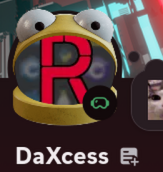
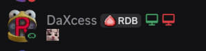

# Discord VR Status

A simple tool to give your Discord account a "VR" status, replacing the standard online indicator with a green VR logo. This new indicator was added back in 2025 after [a collaboration with Meta](https://www.meta.com/en-gb/blog/discord-account-connect-meta-horizon-profile-quest-vr-games-share-status/) that allows showing what you're playing on Discord by connecting your Meta account to Discord.



## How it Works

Discord has a [special endpoint](https://docs.discord.food/resources/presence#create-headless-session) that can be used to create so called "headless sessions". A session in Discord is basically an active Discord application, so say you have Discord open on both your phone and in your web browser, you would have 2 active sessions (phone + web). A headless session is basically the same thing but without a front-facing app (hence headless).

To be able to create a headless session, you need to use an OAuth access token with the `activities.write` scope (and no, user tokens do not work, it **must** be an OAuth token). The `activities.write` scope is private and you cannot use it in your own applications. This is where Meta comes in. We can use Meta's existing application, which has been whitelisted to use the `activities.write` scope, to give us an access token which we can use to create a headless session.

To do this, we first send a user to the Discord OAuth authorization page, where they will be prompted to allow Meta access to their Discord account (`identify`, `activities.read` and `activities.write`). Normally Meta uses the [Authorization Code Grant](https://docs.discord.com/developers/topics/oauth2#authorization-code-grant) flow to get the necessary tokens to change your account's activities. However, since we do not have access to Meta's client secret, we instead opt for [PKCE](https://docs.discord.food/topics/oauth2#pkce) (which, for some reason, isn't documented in Discord's official documentation).

To prevent Meta from immediately using the code given to us by Discord once we authorize, we change the Redirect URL to point to a bogus URL that is still whitelisted by Discord as a valid Redirect URL. This page will throw an error since it no longer is used for this purpose, however we can now copy the URL and extract the code from it, which we can then exchange for an access token and refresh token.

Now that we have an access token with the `activities.write` scope, we can request Discord to make a headless session using Meta's application ID and setting the platform to `meta_quest`, and voila: we now have the VR online status indicator.

## Some important notes

Using this tool to create a new session may override your current online status (idle, dnd, invisible). This means that while using this application, other people can no longer see your real status unless they use a plugin like `PlatformIndicators`.



> VR Status overriding actual status (Do not disturb)

This feature is still relatively new and may contain some subtle bugs. For example, in multiple occasions I was not able to see the VR indicator on my own account, but other people saw it just fine. If you use something like Vencord, you can use the `PlatformIndicators` plugin to see if you have an active VR session.

## Setup & Usage

### Prerequisites

- [Rust](https://www.rust-lang.org/) (if running manually)
- [Docker](https://www.docker.com/) (if running via Docker)

### Interactive Login Sequence

Regardless of how you run the application, the first time you use it requires an interactive login to authorize the application:

1. When you first launch the application it will generate and display a Discord OAuth2 authorization URL.
2. Copy and paste the URL into your browser.
3. Log in to Discord (if needed) and click "Authorize" to connect the Meta app to your account.
4. After authorization, you will be redirected to an `oculus.com` URL. **This page will likely show an error or fail to load, this is expected**.
5. Copy the _entire_ URL from your browser's address bar (which contains the `code` and `state` parameters) and paste it back into the terminal where the program is running.
6. The program will exchange the code for a token and begin updating your status.

Subsequent uses of the application do not require you to log in, as the credentials are cached and renewed when needed. If the cached credentials are deleted or moved, the interactive login sequence will start again.

---

### Running with Cargo

1. Clone the repository:
   ```bash
   git clone https://github.com/DaXcess/discord-vr-status.git
   cd discord-vr-status
   ```
2. Run the application:
   ```bash
   cargo run --release
   ```
3. Follow the [Interactive Login Sequence](#interactive-login-sequence).
4. By default, credentials are saved to `auth.json` in the current directory.

### Running with Docker

1. Build the image:
   ```bash
   docker build -t discord-vr-status .
   ```
2. Run the container:
   ```bash
   docker run -it -v $(pwd)/data:/data discord-vr-status
   ```
   _Note: The `-it` flags are required for the initial interactive login._

#### Persistent Storage

The Docker image is configured to store credentials at `/data/auth.json`. To ensure you don't have to log in every time the container is recreated, mount a local directory or volume to `/data`:

```bash
docker run -d \
  --name discord-vr-status \
  --restart unless-stopped \
  -v /path/to/your/config:/data \
  discord-vr-status
```

## Configuration

The application can be configured using environment variables:

| Variable         | Description                                    | Default                                   |
| ---------------- | ---------------------------------------------- | ----------------------------------------- |
| `AUTH_FILE_PATH` | Path to the JSON file where tokens are cached. | `auth.json` (`/data/auth.json` in Docker) |
